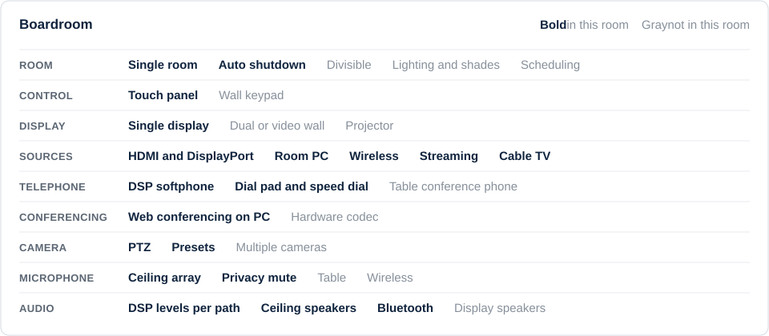

# Crestron Room Demo

A complete Crestron control program for a corporate boardroom, written in SIMPL Windows with SIMPL+ and SIMPL# modules. It runs on a CP3 processor with a 10-inch TSW-1060 touch panel and uses a Q-SYS core for audio.

Project and client details have been removed from this public copy.

## Room type and features

**Boardroom:** single room, one display, table-top control, ceiling microphone and speakers.

## What the room does

- **Presentation:** wired HDMI and DisplayPort at the table, room PC, wireless presentation, streaming devices and cable TV
- **Audio conferencing:** dial pad, speed dial and call status through a Q-SYS softphone
- **Web conferencing:** room PC with a PTZ camera, ceiling microphone and USB audio bridge
- **Audio control:** level and mute for each path, plus privacy mute that follows the room state
- **Bluetooth audio:** pairing, status, mute and a scheduled nightly clear of paired devices
- **Camera control:** pan, tilt, zoom and presets
- **Room shutdown:** one-touch power off with an on-screen countdown

## What it shows

| Skill | Where to look |
|---|---|
| Structured program layout | Startup, System Equipment, System Sources, System Rooms and User Interfaces folders |
| Scalable room and panel design | Equipment and Control Crosspoint routing between rooms and panels |
| Controlled startup | A stepped startup sequence for the panel, DSP, cameras, displays and Bluetooth |
| DSP integration | Q-SYS Named Control modules for gain, mute, snapshots and telephony |
| IP and serial device control | TCP/IP clients, RS-232 and IR |

## Documents

- [Scope of Work](docs/Scope-of-Work.md)
- [System Overview](docs/System-Overview.md)
- [Network and IP Table](docs/Network-and-IP-Table.md)
- [Crestron to Q-SYS Map](docs/Crestron-to-QSYS-Map.md)

## How to open it

1. Download or clone this repository.
2. Open `Program/BRD-1001_Boardroom_slt01.smw` in SIMPL Windows. It was built with version 4.28.
3. Compile for a CP3.

## Current status

- The program compiles from a clean folder.
- This public copy has not been loaded onto hardware.
- The touch panel project and the Q-SYS design file are not included. The Q-SYS map lists every Named Control the program expects.
- Some device modules were written by other programmers and keep their original credits.

## Author

Moe Azizi, Crestron Certified Programmer
