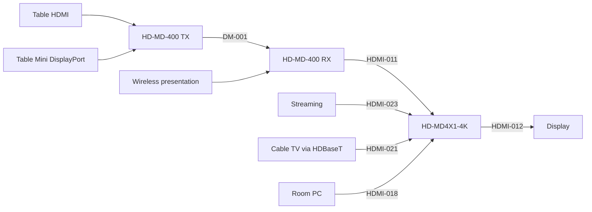
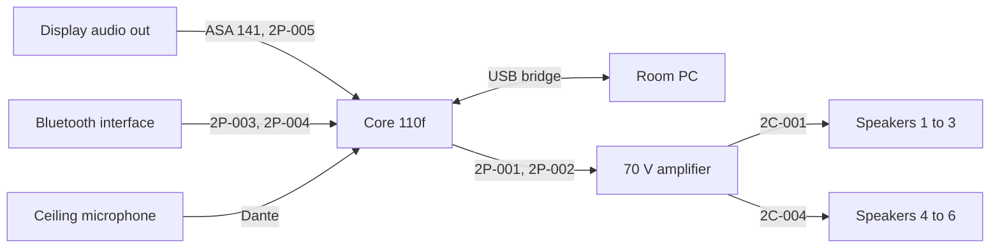

# Connectivity

Cable IDs follow the installation drawings. Switch ports are in the [Network and IP Table](Network-and-IP-Table.md).

## Video path

| Device | Input | Source | Cable |
|---|---|---|---|
| HD-MD-400-C-E TX | HDMI 2 | Table HDMI | HDMI-010 |
| HD-MD-400-C-E TX | HDMI 3 | Table Mini DisplayPort | HDMI-020 |
| HD-MD-400-C-E RX | DM | HD-MD-400-C-E TX | DM-001 |
| HD-MD-400-C-E RX | HDMI 1 | Wireless presentation | HDMI-002 |
| HD-MD4X1-4K-E | HDMI 1 | HD-MD-400-C-E RX | HDMI-011 |
| HD-MD4X1-4K-E | HDMI 2 | Streaming device | HDMI-023 |
| HD-MD4X1-4K-E | HDMI 3 | Cable TV, HDBaseT receiver | HDMI-021 |
| HD-MD4X1-4K-E | HDMI 4 | Room PC | HDMI-018 |
| Display | HDMI | HD-MD4X1-4K-E output | HDMI-012 |

## Audio path

| Core 110f port | Direction | Connects to | Cable |
|---|---|---|---|
| Mic/Line 1 | Input | Display audio out, through ASA 141 | 2P-005 |
| Mic/Line 2 | Input | Bluetooth interface, line out 1 | 2P-003 |
| Mic/Line 3 | Input | Bluetooth interface, line out 2 | 2P-004 |
| Line Out 1 | Output | Amplifier input 1 | 2P-001 |
| Line Out 2 | Output | Amplifier input 2 | 2P-002 |
| Dante | Input | Ceiling microphone | Network |
| Network | Both | USB bridge to room PC | Network, USB-001 |
| LAN A | Network | Control VLAN | PATC-012 |
| LAN B | Network | Audio VLAN | PATC-010 |

Speakers are tapped at 70 V, 7.5 W each, with three on each amplifier output.

## Control

| CP3 port | Connects to | Protocol |
|---|---|---|
| LAN | Network switch | Ethernet |
| IR 1 | Cable TV receiver | IR |
| COM 2 | Bluetooth interface | RS-232, 9600 8N1 |
| Cresnet | Control block | Cresnet |

Display, camera, microphone and video switchers are controlled over Ethernet.

## USB and table connections

| From | To | Cable |
|---|---|---|
| Room PC | USB bridge | USB-001 |
| Room PC | PTZ camera | USB-002 |
| Table box | Touch panel, PoE | PATC-020 |
| Wall interface | Bluetooth rack interface | CAT-009 |
