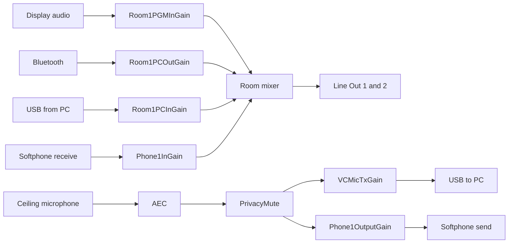

# Q-SYS Build Sheet

Start from the existing demo design, or a new design, in Q-SYS Designer 9.1.2 or later.

## 1. Inventory

| Item | Setting |
|---|---|
| Core | Core 110f |
| Control address | 192.168.20.81 |
| Audio address | 192.168.30.81 |
| Peripheral | I/O-USB-Bridge |
| Dante | One receive channel for the ceiling microphone |
| Softphone | One line |
| Snapshot bank | Three snapshots |

## 2. Inputs and outputs

| Core port | Signal | Starting preamp or level |
|---|---|---|
| Mic/Line 1 | Display audio | Line level |
| Mic/Line 2 | Bluetooth left | Line level |
| Mic/Line 3 | Bluetooth right | Line level |
| Dante RX 1 | Ceiling microphone | Automix output from the microphone |
| USB bridge in | Room PC playback | 0 dB |
| USB bridge out | Room PC microphone | 0 dB |
| Line Out 1 | Amplifier zone 1 | 0 dB |
| Line Out 2 | Amplifier zone 2 | 0 dB |

## 3. Signal flow

Feed the AEC reference from the room mixer output. Add far-end cross-feeds so a phone caller hears the PC and the PC hears the phone caller.

## 4. Gain blocks

Add one gain block per row and name its controls exactly.

| Gain block | Gain Named Control | Mute Named Control |
|---|---|---|
| Display audio | `Room1PGMInGain` | `Room1PGMInMute` |
| Bluetooth | `Room1PCOutGain` | `Room1PCOutMute` |
| PC playback | `Room1PCInGain` | `Room1PCInMute` |
| Microphone to PC | `VCMicTxGain` | `VCMicTxMute` |
| Softphone receive | `Phone1InGain` | `Phone1InMute` |
| Softphone send | `Phone1OutputGain` | `Phone1OutputMute` |
| Microphone master | None | `PrivacyMute` |

## 5. Softphone Named Controls

| Softphone control | Named Control |
|---|---|
| Connect | `Phone1CallControlConnect` |
| Disconnect | `Phone1CallControlDisconnect` |
| Hook Flash | `Phone1CallControlHookFlash` |
| Dial String | `Phone1CallControlDialString` |
| Do Not Disturb | `Phone1CallControlDoNotDisturb` |
| Auto Answer | `Phone1CallControlAutoAnswer` |
| Call Status | `Phone1CallStatusProgress` |
| Ringing | `Phone1CallStatusRinging(state)` |
| Off Hook | `Phone1CallStatusOffHook` |
| DTMF Rx | `Phone1DTMFRx` |
| Pin Pad 0 to 9 | `Phone1PinPad0` to `Phone1PinPad9` |
| Pin Pad * | `Phone1PinPad*` |
| Pin Pad # | `Phone1PinPad#` |
| Backspace | `Phone1PinPadBackspace` |
| Clear | `Phone1PinPadClear` |

Enter SIP details on the core: server `XXX.XXX.XXX.XXX`, user `XXXXXXXX`, password `XXXXXXXX`.

## 6. Snapshots

| Snapshot | Load control Named Control | Use |
|---|---|---|
| 1 | `Preset1` | Microphone preset 1 |
| 2 | `Preset2` | Microphone preset 2 |
| 3 | `Preset3` | Microphone preset 3 |

## 7. Deploy and test

1. Save the design and run it on the core.
2. Allow the CP3 to connect to the core on the control network.
3. Confirm each Named Control responds from the touch panel.
4. Set room levels and store the snapshots.
