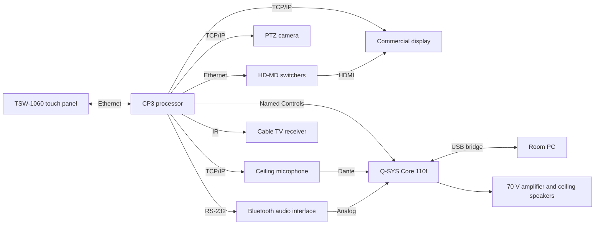

# System Overview

## Signal and control

## Equipment

| Function | Device | Control |
|---|---|---|
| Control processor | Crestron CP3 | Program host |
| Touch panel | Crestron TSW-1060 | Ethernet |
| Video switching | Crestron HD-MD-400-C-E and HD-MD4X1-4K-E | Ethernet |
| Display | Sharp PN-LE series, 70 inch | TCP/IP |
| Audio DSP | Q-SYS Core 110f | Named Controls over IP |
| Microphone | Shure MXA910 ceiling array | TCP/IP, Dante audio |
| PC audio | QSC I/O USB Bridge | Through Q-SYS |
| Bluetooth audio | Attero Tech unBT2A | RS-232 |
| Camera | Vaddio PTZ camera | TCP/IP |
| Wireless presentation | Barco ClickShare | Source only |
| TV | Cable receiver | IR |

## Touch panel pages

| Page | Functions |
|---|---|
| Home | Choose Source, Audio Conference or Television |
| Source | Seven sources and content volume |
| Audio Conference | Dial pad, call status, caller volume and hang up |
| Television | Channel, guide, volume and presets |
| Advanced Audio | Content, Telephone In and Out, PC In and Bluetooth levels |
| Bluetooth | Device name, status, mute and pairing |
| Camera Controls | Pan, tilt, zoom and presets |
| Assistance | Support contact |

## Program structure

| Folder | Purpose |
|---|---|
| Startup | Boot sequence and default states |
| Clock | Time-of-day events |
| Assign Crosspoints | Room-to-panel assignment |
| System Equipment | Device drivers and hardware logic |
| System Sources | Source names, icons, availability and power |
| System Rooms | Room behaviour and modes |
| System Interfaces | Panel pages and control routing |

Equipment for other room types, such as video codecs and room partitioning, remains in the program but is commented out.
